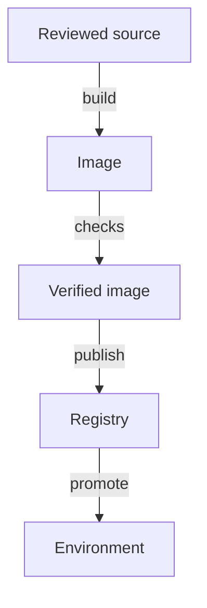

# Source Changes And Build Evidence

A developer changes the `scout` application and pushes the change. Source code is the human-written input to a build. An artifact is the packaged output of a build that another stage can use, for example a container image. A delivery pipeline is the automation that turns a reviewed source revision into a tested artifact that a team can deploy. This part follows one change through those steps and shows what evidence each step leaves behind.

Continuous integration (CI) means that developers merge changes into a shared branch often and that every merge starts automated checks. The checks can compile the code, run unit tests, run integration tests and run static analysis. A passing run is evidence that these specific checks passed. It is not proof that production behaves correctly.



The diagram shows the order of the steps: the build creates the image once, the checks run against it, and only a verified image is published and promoted.

## A check is a process with an exit code

Every pipeline stage is a process. The pipeline runner starts it, waits for it to end and reads its exit code. Exit code `0` means success and any other code means failure. A failing code stops later stages, so the pipeline never promotes an artifact that failed a check. Kubernetes has the same rule for a `Job`: it runs a pod until the main process exits, then it records `Complete` or `Failed`.

<!-- astrona:playground:renew -->

Save this as `job-unit-check.yaml`. The Job stands in for a passing check. It asks the `scout` Service for its health endpoint and exits with the result of that request:

```yaml
apiVersion: batch/v1
kind: Job
metadata:
  name: unit-check
  namespace: starfleet
spec:
  backoffLimit: 0
  template:
    spec:
      restartPolicy: Never
      containers:
        - name: check
          image: curlimages/curl:8.22.0
          command: ["sh", "-c", "curl -fsS http://scout.starfleet.svc.cluster.local/healthz"]
```

Apply it:

```sh
kubectl apply -f job-unit-check.yaml
```

Then check the result:

```sh
kubectl -n starfleet wait --for=condition=complete job/unit-check --timeout=90s
kubectl -n starfleet get job unit-check
```

The `curl -f` flag makes `curl` exit with a non-zero code when the server answers with an HTTP error status. Because `scout` is healthy, the Job completes and `get job` shows one successful completion. Here the Job controller recorded the result, and the `curl` process produced it.

Now save a check that fails on purpose as `job-failing-check.yaml`. Its process exits with code `3`, and `backoffLimit: 0` tells the Job controller not to retry:

```yaml
apiVersion: batch/v1
kind: Job
metadata:
  name: failing-check
  namespace: starfleet
spec:
  backoffLimit: 0
  template:
    spec:
      restartPolicy: Never
      containers:
        - name: check
          image: curlimages/curl:8.22.0
          command: ["sh", "-c", "echo 'integration test failed'; exit 3"]
```

Apply it and read the Job conditions:

```sh
kubectl apply -f job-failing-check.yaml
kubectl -n starfleet wait --for=condition=failed job/failing-check --timeout=90s
kubectl -n starfleet get job failing-check -o jsonpath='{.status.conditions[*].type}'
```

The condition `Failed` is the evidence a pipeline runner would act on. A pipeline that ignores it and promotes anyway has removed its own protection. A failed check should give useful evidence: the pod log of this Job holds the message `integration test failed`, which you can read with `kubectl -n starfleet logs job/failing-check`.

## Build identity: tag, digest and revision

A registry stores an image under a name and a tag, such as `ghcr.io/stefanprodan/podinfo:6.15.0`. A tag is a label that the image owner can move to a different image later. A digest is the SHA-256 hash of the image manifest, written as `repository@sha256:<hex>`. A digest identifies exact content, so it cannot point at a different image later.

You can read what `scout` runs. The Deployment records the image reference you wrote, and each pod status records the image the runtime resolved:

```sh
kubectl -n starfleet get deployment scout -o jsonpath='{.spec.template.spec.containers[0].image}{"\n"}'
kubectl -n starfleet get pods -l app=scout -o jsonpath='{.items[0].status.containerStatuses[0].imageID}{"\n"}'
```

The first command prints the tag reference. The second prints the `imageID`, which the container runtime fills in. Depending on the runtime and on how the image reached the node, it can show a digest reference or a local image ID, so read it as the runtime's own record of the image it started.

Pinning by digest removes the uncertainty. If a team wrote `scout:6.15.0` and the owner later pushed a different image under that tag, a new pod could run different bytes with no change to the Deployment. A reference such as `ghcr.io/stefanprodan/podinfo@sha256:<digest>` always resolves to the same content. A release record therefore needs three facts: the source revision, the controlled build inputs (dependency versions, base image, build tool) and the artifact digest.

## Record the evidence with the release

Kubernetes lets you attach metadata to the Deployment so the evidence travels with the release. Annotations hold free-form text. Save the source revision and build number that produced the image:

```sh
kubectl -n starfleet annotate deployment scout release.astrona.io/source-revision=4f2a9c1 release.astrona.io/build-id=build-1287 --overwrite
kubectl -n starfleet get deployment scout -o jsonpath='{.metadata.annotations}{"\n"}'
```

The annotation `kubernetes.io/change-cause` is special: `kubectl rollout history` prints it in its `CHANGE-CAUSE` column. Set it, then read the history:

```sh
kubectl -n starfleet annotate deployment scout kubernetes.io/change-cause="build-1287 from 4f2a9c1" --overwrite
kubectl -n starfleet rollout history deployment/scout
```

A rebuild of the same source can still produce different output, because a dependency, a base image or a tool changed in the meantime. For that reason the pipeline builds once, tests that exact image and promotes it, instead of building again for each environment.

## Common pitfalls

> [!WARNING]
> A passing pipeline proves only that its configured checks passed. A rebuild after testing can produce a different image unless the build inputs are controlled. A tag such as `latest` or `6.15.0` can move; only a digest cannot. A failed check that the runner ignores protects nothing.
