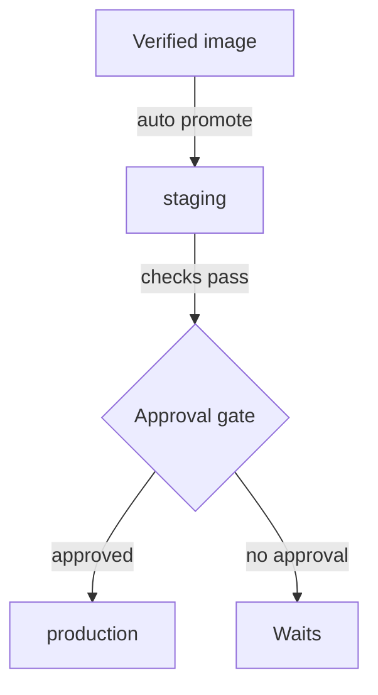

# Delivery, Deployment And Promotion Decisions

A verified image exists. The next decision is who or what puts it into production, and how the team keeps the tested image identical across environments. Two terms describe the decision. Continuous delivery means every change that passes the pipeline is kept in a releasable state, and a person or a policy approves the final deployment. Continuous deployment means the pipeline deploys every passing change to production automatically, with no manual approval.

Both practices share the same checks. They differ only in the last gate. A team picks continuous delivery when a release needs a business decision, a change window or an audit approval. A team picks continuous deployment when automated checks and fast rollback give enough confidence to release on every merge.



The diagram shows continuous delivery: the image reaches staging on its own and waits at the gate before production. Continuous deployment removes the gate.

## Promote the same image, change only the configuration

Promotion means moving one artifact from an environment to the next. The staging result only says something about production when production receives the same bytes. So the pipeline copies the image reference and leaves the environment-specific values, such as a message, a database address or a replica count, in separate configuration.

<!-- astrona:playground:renew -->

First read the staging release. The `scout` image reference is the value to promote:

```sh
kubectl -n starfleet get deployment scout -o jsonpath='{.spec.template.spec.containers[0].image}{"\n"}'
```

Save this as `scout-production-config.yaml`. A ConfigMap is a Kubernetes object that stores configuration as key and value pairs outside the image. The `podinfo` application reads the variable `PODINFO_UI_MESSAGE` for the text it returns:

```yaml
apiVersion: v1
kind: ConfigMap
metadata:
  name: scout-config
  namespace: outpost
data:
  PODINFO_UI_MESSAGE: scout-production
```

Apply it:

```sh
kubectl apply -f scout-production-config.yaml
```

Now save the production Deployment as `deployment-scout-production.yaml`. It uses the image reference you read from staging and takes its configuration from the ConfigMap through `envFrom`:

```yaml
apiVersion: apps/v1
kind: Deployment
metadata:
  name: scout
  namespace: outpost
  annotations:
    release.astrona.io/source-revision: 4f2a9c1
    release.astrona.io/build-id: build-1287
    kubernetes.io/change-cause: promoted build-1287 from staging
spec:
  replicas: 2
  selector:
    matchLabels:
      app: scout
  template:
    metadata:
      labels:
        app: scout
    spec:
      containers:
        - name: scout
          image: ghcr.io/stefanprodan/podinfo:6.15.0
          envFrom:
            - configMapRef:
                name: scout-config
          ports:
            - name: http
              containerPort: 9898
          readinessProbe:
            httpGet:
              path: /readyz
              port: http
```

Apply it and wait for the rollout:

```sh
kubectl apply -f deployment-scout-production.yaml
kubectl -n outpost rollout status deployment/scout --timeout=120s
```

Then compare the two environments. The image reference is equal and the message differs:

```sh
kubectl -n starfleet get deployment scout -o jsonpath='{.spec.template.spec.containers[0].image}{"\n"}'
kubectl -n outpost get deployment scout -o jsonpath='{.spec.template.spec.containers[0].image}{"\n"}'
kubectl -n outpost get configmap scout-config -o jsonpath='{.data}{"\n"}'
```

If production later misbehaves, the investigation starts from a short list: image identity, effective configuration and dependencies. Nobody has to ask whether an undocumented rebuild changed the bytes.

## An approval gate in a promotion step

A pipeline stage that promotes only after approval has one extra job: it reads a decision recorded somewhere and exits non-zero when the decision is missing. In a real pipeline the approval is a button or a review. Here the decision is an annotation on the staging Deployment, and a shell function plays the promotion step. Paste it into your terminal:

```sh
promote_if_approved() {
  approved="$(kubectl -n starfleet get deployment scout -o jsonpath='{.metadata.annotations.release\.astrona\.io/approved}')"
  if [ "$approved" != "true" ]; then
    echo "not approved: production unchanged"
    return 1
  fi
  echo "approved: promoting"
}
```

Run `promote_if_approved`. It prints `not approved: production unchanged` and returns `1`, so a pipeline would stop. Record the approval and run it again:

```sh
kubectl -n starfleet annotate deployment scout release.astrona.io/approved=true
promote_if_approved
```

Continuous delivery has this gate. Continuous deployment would call the promotion step without reading any approval. Neither choice changes the image: the promoted artifact is the one that passed the checks.

## Deployment is not the same as exposure

Deploying a release puts the new pods in the cluster. Exposing a feature decides whether users see it. A team can deploy code with a feature switched off by a configuration value, and switch it on later by changing only the ConfigMap. This separates the risk of the new code from the risk of the new behavior. Changing the ConfigMap does not restart pods that already read it as environment variables, so a rollout restart is still needed to apply it.

Release control also needs scoped credentials. The identity a pipeline uses to deploy should hold only the rights it needs in the target namespace, and a recovery plan must cover configuration and data changes, because an image rollback restores only the image.

## Common pitfalls

> [!WARNING]
> Continuous delivery and continuous deployment are not the same. The first keeps a manual or policy gate before production; the second has none. Promoting by rebuilding for each environment breaks the link between test evidence and deployed bytes. Environment values belong in configuration, not in a different image.
