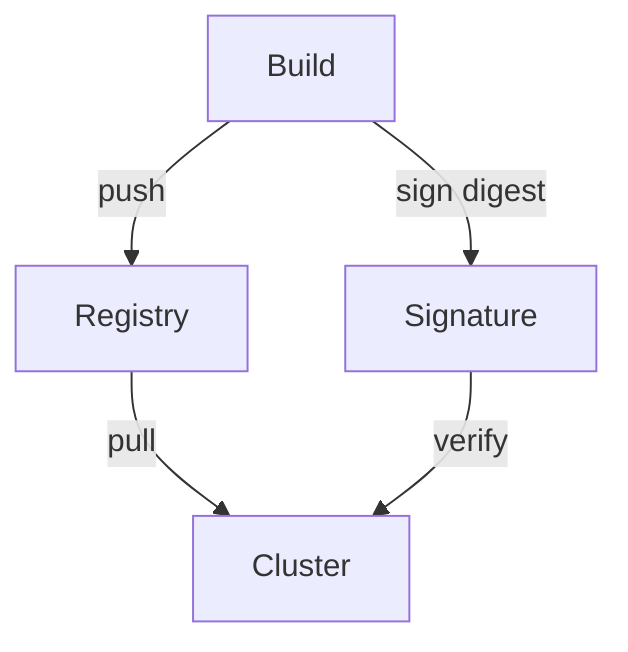

# Registries, Image Signing And Supply Chain

A pipeline ends with an image in a registry, and the cluster pulls that image later. Between the build and the pull, many things can go wrong: someone can replace the image, a dependency can hold a known vulnerability, or the cluster can run an image that no pipeline built. This part explains how a registry stores images, how a team proves where an image came from, and how a cluster can refuse images that do not meet the rule.

## How a registry stores an image

A container registry is a server that stores images and serves them over HTTP. Images follow the Open Container Initiative (OCI) format. An image is a manifest, which lists the layers and the configuration, plus the layer files. The manifest has a digest: a SHA-256 hash written as `sha256:<hex>`. A reference like `registry.example.com/scout:1.4.0` uses a tag, and a reference like `registry.example.com/scout@sha256:<hex>` uses the digest.

A tag is a name that the registry maps to a digest, and the owner can change that mapping. A digest cannot change, because it is the hash of the content. For that reason a release record keeps the digest. Many registries can also mark a tag as immutable, which stops anyone from moving it.

The registry also decides who may push and who may pull. A private registry needs credentials. Kubernetes gets them from an `imagePullSecret`, a Secret of type `kubernetes.io/dockerconfigjson` that a pod lists in `spec.imagePullSecrets`.

## Look at what the cluster pulled

The playground has an image that `scout` uses. You can read the reference you wrote and what the container runtime recorded:

<!-- astrona:playground:renew -->

```sh
kubectl -n starfleet get deployment scout -o jsonpath='{.spec.template.spec.containers[0].image}{"\n"}'
kubectl -n starfleet get pod -l app=scout -o jsonpath='{.items[0].status.containerStatuses[0].image}{"\n"}{.items[0].status.containerStatuses[0].imageID}{"\n"}'
```

The first line is the reference from the Deployment. The next two lines are the image name and the `imageID` the runtime stored. Depending on the runtime, the `imageID` can show a digest. The pull policy decides when the kubelet pulls: `Always`, `IfNotPresent` or `Never`. When the tag is `latest` and no policy is set, Kubernetes uses `Always`; for other tags it uses `IfNotPresent`. Check what the pod uses:

```sh
kubectl -n starfleet get pod -l app=scout -o jsonpath='{.items[0].spec.containers[0].imagePullPolicy}{"\n"}'
```

## Software supply chain

The software supply chain is every step and every input between a developer's change and the running container: source, dependencies, build tools, base images, the pipeline, the registry and the cluster. An attacker can target any of them. Four practices reduce the risk.

1. Scan images. A vulnerability scanner (Trivy and Grype are common) compares the packages in an image with databases of known vulnerabilities and reports them. A scan finds known problems only.
2. Create a Software Bill of Materials (SBOM). An SBOM lists every package and version inside an image, in a format such as SPDX or CycloneDX. When a new vulnerability is announced, the team searches the SBOMs to see which images are affected.
3. Sign images. A signature is created with a private key by the pipeline and stored in the registry next to the image. The tool Cosign, from the Sigstore project, signs and verifies images. Anyone with the public key, or with the identity rules of keyless signing, can verify that the image digest was signed by the expected pipeline.
4. Record provenance. Provenance is a signed statement of how an image was built: the source revision, the builder and the build inputs. The Supply-chain Levels for Software Artifacts (SLSA) framework describes levels of build integrity.

A signature belongs to a digest. If you sign a tag, the signature does not follow a tag that moves. That is another reason to deploy by digest.



The diagram shows that the signature is created at build time and checked again when the image reaches the cluster.

## Enforce the rule in the cluster

Signing only helps when something checks it. An admission controller is a component that receives each API request after authentication and can allow, change or reject it. A policy engine such as Kyverno or Open Policy Agent Gatekeeper runs as an admission controller. A policy can reject any pod whose image has no valid signature, uses the `latest` tag, or comes from a registry that is not on the approved list.

You can see the admission chain in the cluster, because the API server lists the registered webhooks:

```sh
kubectl get validatingwebhookconfigurations
kubectl get mutatingwebhookconfigurations
```

The playground cluster has no policy engine, so the lists can be empty. A cluster with a policy engine shows its webhook configurations here. Pod Security Admission is built into the API server, but it checks pod security settings and does not check image signatures.

## Common pitfalls

> [!WARNING]
> A scan result is only as new as its vulnerability database; rescan images that are already running. A signed tag proves nothing after the tag moves, so verify the digest. Admission policy that is set to warn only does not block anything. Credentials in an `imagePullSecret` are readable by anyone who can read Secrets in that namespace.
