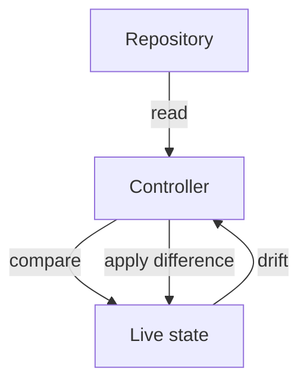

# GitOps Reconciliation And Drift

A team that deploys with `kubectl apply` from a laptop has no answer to the question "what should be running right now?" The live cluster holds one answer, a laptop holds another, and a quick manual fix in production holds a third. GitOps removes the question by naming one source of truth. This part builds the loop that enforces it and creates drift to watch the loop correct it.

Four ideas define GitOps. The desired state is declarative: manifests say what must exist, not which steps to run. It is versioned: every change is a commit with an author and a history, so a rollback is another commit. It is pulled: an agent in the cluster reads the repository and applies it, instead of an outside pipeline pushing in with cluster credentials. It is continuously reconciled: the agent compares live state with desired state again and again and corrects the difference.



The diagram shows the loop: the controller reads the repository, compares it with the live state and applies the difference. When someone changes the live state by hand, the next comparison finds the drift.

## Declare the desired state

The playground has no Git server, so you store the desired state in a ConfigMap. Create the namespace and save the manifest as `relay.yaml`. The Deployment carries the label `app.kubernetes.io/part-of: relay`, which the pruning step below needs:

<!-- astrona:playground:renew -->

```yaml
apiVersion: apps/v1
kind: Deployment
metadata:
  name: relay
  namespace: outpost
  labels:
    app: relay
    app.kubernetes.io/part-of: relay
spec:
  replicas: 2
  selector:
    matchLabels:
      app: relay
  template:
    metadata:
      labels:
        app: relay
    spec:
      containers:
        - name: relay
          image: ghcr.io/stefanprodan/podinfo:6.15.0
          env:
            - name: PODINFO_UI_MESSAGE
              value: relay-v1
          ports:
            - name: http
              containerPort: 9898
```

Create the stand-in repository from that file:

```sh
kubectl create namespace gitops-repo
kubectl -n gitops-repo create configmap desired-state --from-file=relay.yaml
```

Now write the reconciliation step as a shell function. It reads the manifest from the ConfigMap, shows the difference between the manifest and the live cluster with `kubectl diff`, and then applies the manifest. `kubectl diff` exits with code `1` when a difference exists, which is not an error here:

```sh
reconcile() {
  kubectl -n gitops-repo get configmap desired-state -o jsonpath='{.data.relay\.yaml}' > relay-desired.yaml
  kubectl diff -f relay-desired.yaml
  kubectl apply -f relay-desired.yaml
}
```

Run `reconcile` once. The first `diff` lists the whole Deployment as new, and `apply` creates it. Run it a second time: `diff` prints nothing, because live state already equals desired state. A reconciliation loop that finds no difference does nothing.

## Create drift and correct it

Drift is any difference between live state and desired state that did not come from a repository change. Simulate a hotfix made by hand: scale the Deployment and change the message.

```sh
kubectl -n outpost scale deployment relay --replicas=5
kubectl -n outpost set env deployment/relay PODINFO_UI_MESSAGE=hotfix
reconcile
```

The `diff` now shows the replica count and the environment value moving back to `2` and `relay-v1`, and `apply` writes them. Here `kubectl diff` found the drift and `kubectl apply` corrected it. A real controller runs this loop on a timer and also reacts to cluster events, so nobody has to type `reconcile`. Pull-based means the controller inside the cluster reaches out to the repository; the repository and the CI system never need credentials for the cluster API.

You can see which manager owns each field. Kubernetes records field ownership in `managedFields`:

```sh
kubectl -n outpost get deployment relay --show-managed-fields -o yaml
```

The output lists each manager, such as `kubectl-client-side-apply` or `kubectl`, with the fields it set. Server-side apply (`kubectl apply --server-side`) makes this ownership explicit: if two managers claim the same field with different values, the API server reports a conflict instead of silently overwriting.

## Remove what the repository does not list

Reconciliation also covers deletion. An object that someone created by hand and that the repository does not list is drift too. `kubectl apply --prune` deletes live objects that carry a selected label and are missing from the applied manifests. Create an extra object with the label, then reconcile with pruning:

```sh
kubectl -n outpost create deployment relay-extra --image=ghcr.io/stefanprodan/podinfo:6.15.0
kubectl -n outpost label deployment relay-extra app.kubernetes.io/part-of=relay
kubectl apply --prune -l app.kubernetes.io/part-of=relay -f relay-desired.yaml
```

The `relay-extra` Deployment is deleted, because it has the label and is not in the file. Without the label selector, prune would not know which objects belong to this application. GitOps controllers record the objects they own and prune the ones that leave the repository.

## What a controller cannot infer

A controller knows the repository and the cluster. It cannot know anything outside them. It cannot tell whether a manual change was a mistake or an urgent fix that the team forgot to commit; it reverts both. It cannot restore data in a database or a volume. It cannot read a Secret that was kept out of the repository on purpose, so the Secret must come from a secret manager or an encrypted file. It does not know whether the new version is healthy for users: reconciliation confirms that the objects match, not that the application works.

## Common pitfalls

> [!WARNING]
> Drift correction reverts every manual change, including a useful hotfix that was never committed. Pruning without a label selector is refused, and a wrong selector deletes objects. A repository that contains a plain-text Secret exposes it to everyone who can read the repository. A synced application is not the same as a healthy application.
