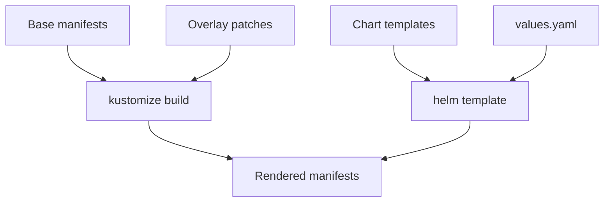

# Helm, Kustomize And Configuration Rendering

The repository of a GitOps setup holds manifests, and one application usually needs several variants of them: a different replica count in production, a different image tag in staging, a different hostname per customer. Copying and editing the YAML for each variant makes the copies drift apart. Helm and Kustomize solve this in different ways. This part renders the same application with each tool, so the difference is visible in the output.

Helm is a package manager for Kubernetes. A chart is a directory of templates and a `values.yaml` file with default values. Helm fills the templates with values and sends the result to the cluster as a release. Kustomize needs no templates. It takes plain, valid manifests as a base and layers patches on top in an overlay. `kubectl` includes Kustomize.



The diagram shows two ways to reach the same result: Kustomize combines a base with an overlay, and Helm combines templates with values.

## Kustomize: a base and an overlay

A base is a valid set of manifests with a `kustomization.yaml` that lists them. An overlay is a second directory whose `kustomization.yaml` points at the base and changes selected fields. Create the directories and save the base:

<!-- astrona:playground:renew -->

```sh
mkdir -p base overlays/production
```

Save this as `base/deployment.yaml`:

```yaml
apiVersion: apps/v1
kind: Deployment
metadata:
  name: beacon
spec:
  replicas: 1
  selector:
    matchLabels:
      app: beacon
  template:
    metadata:
      labels:
        app: beacon
    spec:
      containers:
        - name: beacon
          image: ghcr.io/stefanprodan/podinfo
          ports:
            - name: http
              containerPort: 9898
```

Save this as `base/kustomization.yaml`:

```yaml
apiVersion: kustomize.config.k8s.io/v1beta1
kind: Kustomization
resources:
  - deployment.yaml
```

Save this as `overlays/production/kustomization.yaml`. It uses the base, sets the namespace, sets the replica count, sets the image tag and adds a label to the object and to its pod template:

```yaml
apiVersion: kustomize.config.k8s.io/v1beta1
kind: Kustomization
namespace: outpost
resources:
  - ../../base
replicas:
  - name: beacon
    count: 2
images:
  - name: ghcr.io/stefanprodan/podinfo
    newTag: 6.15.0
labels:
  - pairs:
      env: production
    includeTemplates: true
```

Render the overlay first. `kubectl kustomize` prints the manifests and changes nothing in the cluster:

```sh
kubectl kustomize overlays/production
```

Read the output: the Deployment is in `outpost`, has `replicas: 2`, uses the image `ghcr.io/stefanprodan/podinfo:6.15.0` and carries the label `env: production`. The base files are unchanged. Apply the overlay with `-k`, which means "build this directory and apply the result":

```sh
kubectl apply -k overlays/production
kubectl -n outpost rollout status deployment/beacon
```

A new environment is a new overlay directory. The base stays the single place for what all environments share.

## Helm: templates and values

A chart separates the templates from the values. Create the chart directory and save three files:

```sh
mkdir -p chart/templates
```

Save this as `chart/Chart.yaml`:

```yaml
apiVersion: v2
name: lantern
description: A small web application
version: 0.1.0
appVersion: "6.15.0"
```

Save this as `chart/values.yaml`:

```yaml
replicas: 1
image:
  repository: ghcr.io/stefanprodan/podinfo
  tag: 6.15.0
message: lantern-default
```

Save this as `chart/templates/deployment.yaml`. The double braces mark where Helm inserts a value:

```yaml
apiVersion: apps/v1
kind: Deployment
metadata:
  name: {{ .Release.Name }}
spec:
  replicas: {{ .Values.replicas }}
  selector:
    matchLabels:
      app: {{ .Release.Name }}
  template:
    metadata:
      labels:
        app: {{ .Release.Name }}
    spec:
      containers:
        - name: app
          image: "{{ .Values.image.repository }}:{{ .Values.image.tag }}"
          env:
            - name: PODINFO_UI_MESSAGE
              value: {{ .Values.message | quote }}
          ports:
            - name: http
              containerPort: 9898
```

Render it with an override, then install it. `--set` replaces one value, and `-n outpost` selects the namespace:

```sh
helm template lantern ./chart --set replicas=2
helm install lantern ./chart -n outpost --set replicas=2
helm upgrade lantern ./chart -n outpost --set replicas=3 --set message=lantern-v2
helm get values lantern -n outpost
```

`helm template` only renders. `helm install` creates a release, and `helm upgrade` creates a new revision of it. Helm stores each revision as a Secret in the release namespace. List them with `kubectl -n outpost get secrets -l owner=helm`. This stored history is how `helm rollback` returns to an earlier revision.

## Choose by what changes

Templating inserts values into a template and can express logic, loops and conditions, so it suits an application that others install with their own settings. The cost is that the template is not valid YAML until it is rendered, and a wrong value shows up only at render time. Overlays keep every file valid and show exactly which fields differ per environment, but they cannot loop or compute. Teams also combine them: render a chart with `helm template` and then patch the result with Kustomize. In either case, a GitOps controller applies the rendered manifests, so the repository can hold the chart and the values, or the base and the overlays.

## Common pitfalls

> [!WARNING]
> `helm install` and `kubectl apply` on the same objects create two owners for one object. A `--set` flag typed in a terminal is not recorded in the repository; put values in a file under version control. A Kustomize overlay with a namespace field changes only objects it lists. Rendering success does not prove the manifests are valid for the cluster.
