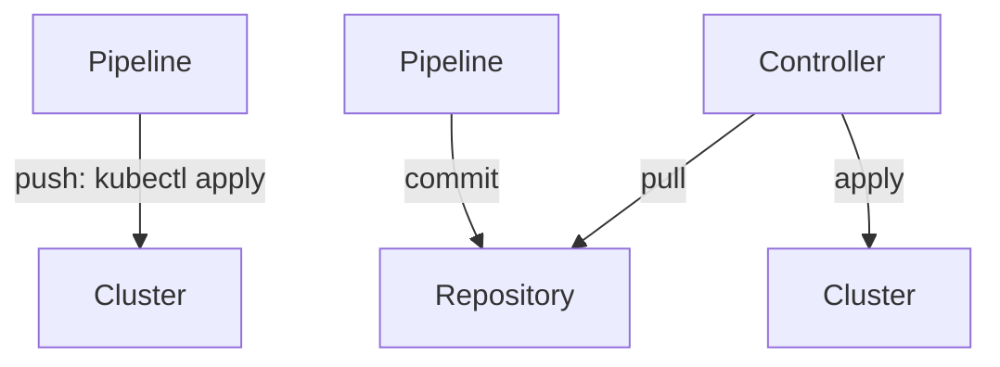

# GitOps Principles And Push Versus Pull

Teams adopt GitOps to answer questions that ad hoc deployments cannot: who changed production, what exactly is running, and how to go back. The practice rests on a short list of principles. This part states them as the OpenGitOps project defines them, explains why each one exists, and compares two ways to deliver a change to a cluster: push and pull. A short hands-on step then shows how a cluster records which tool changed an object.

## The four OpenGitOps principles

OpenGitOps is a working group of the Cloud Native Computing Foundation (CNCF) that wrote a vendor-neutral definition of GitOps. It has four principles.

1. Declarative. The desired state of the system is expressed declaratively. A manifest says what must exist, for example three replicas of an image, and not which commands to run.
2. Versioned and immutable. The desired state is stored in a way that keeps a complete history and cannot be changed without leaving a trace. Git is the usual store. Every change is a commit with an author, a time and a message, and a rollback is a new commit.
3. Pulled automatically. Software agents pull the desired state from the source. The agent runs next to the cluster and reads the repository, so no outside system needs write access to the cluster.
4. Continuously reconciled. Software agents observe the actual state and try to make it match the desired state, again and again, not once per release.

Git is not named in the principles. The principles need a store with history and integrity, and Git provides that. A tool that applies a manifest once from a pipeline and then stops watching satisfies the first two principles and fails the last two.

## Push delivery and pull delivery

In push delivery, a CI/CD pipeline holds the cluster credentials and applies the change with `kubectl apply` or `helm upgrade` after the build. The pipeline knows when it ran and nothing afterwards. If someone edits an object by hand, the pipeline does not notice until the next run.

In pull delivery, a GitOps controller inside the cluster reads the repository and applies it. The pipeline only builds the image and changes a file in the repository, so it needs write access to the repository and no access to the cluster. The controller compares the live objects with the repository on an interval and when it receives a webhook.



The diagram shows that push delivery sends changes into the cluster from outside, while pull delivery lets a controller inside the cluster read the repository.

Pull delivery has three practical benefits. The cluster credentials stay inside the cluster. Drift is corrected without a new pipeline run. The repository becomes the audit log of every change. It also has costs: a team must run and update the controller, and an error in the repository reaches the cluster without a human step, so review of the repository matters more.

## See who last changed an object

Kubernetes records the manager that wrote each field. This record is called managed fields, and it lets you tell a controller's change from a manual one. Apply a ConfigMap, then read the field manager:

<!-- astrona:playground:renew -->

Save this as `configmap-relay-settings.yaml`:

```yaml
apiVersion: v1
kind: ConfigMap
metadata:
  name: relay-settings
  namespace: outpost
data:
  mode: standard
```

Apply it:

```sh
kubectl apply -f configmap-relay-settings.yaml
```

Then check the result:

```sh
kubectl -n outpost get configmap relay-settings --show-managed-fields -o yaml
```

The output has a `managedFields` list. The entry for this change names the manager `kubectl-client-side-apply` and the operation `Update`. A controller that applies the same object would appear under its own manager name. Here the API server wrote the record, and `kubectl` only displayed it. Now change the value by hand and read the record again:

```sh
kubectl -n outpost patch configmap relay-settings --type merge -p '{"data":{"mode":"debug"}}'
kubectl -n outpost get configmap relay-settings --show-managed-fields -o yaml
```

The manager of the `mode` field changes to `kubectl-patch`. A GitOps controller that sees a field owned by another manager has found drift and can correct it.

You now know the principles and the two delivery models. The open question is which real tools implement the pull model, and what their resources look like.

## Common pitfalls

> [!WARNING]
> Putting manifests in Git is not GitOps if nothing reconciles them. A pipeline that runs `kubectl apply` after each commit is push delivery. A controller with cluster-admin rights can apply anything in the repository, so protect the branch it reads. Manual fixes in production are overwritten by the next reconciliation.
