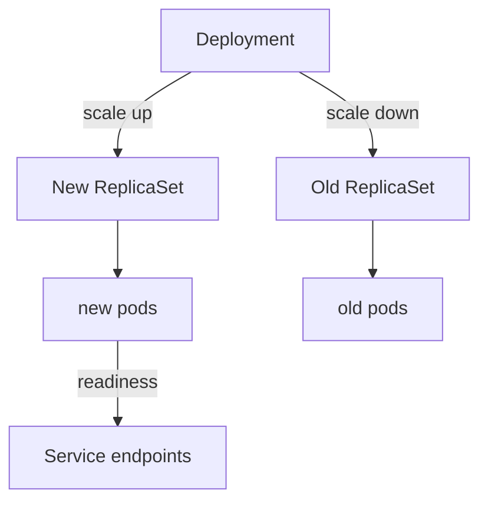

# Rolling Updates And Health Gates

Stopping all old pods and then starting all new pods causes an outage between the two steps. A rolling update avoids it: the Deployment controller replaces pods a few at a time, so some pods always serve requests. The cost is that old and new versions run side by side for a while. This part runs a rolling update, shows how a health gate stops a bad version from taking over, and rolls the release back.

A Deployment does not manage pods directly. It manages ReplicaSets. A ReplicaSet keeps a set number of identical pods running. Each time the pod template changes, the Deployment controller creates a new ReplicaSet for the new template, scales it up and scales the old ReplicaSet down. Only a change to the pod template starts a rollout; a change to the replica count does not.



The diagram shows that the Deployment moves pods from the old ReplicaSet to the new one, and that only pods that pass their readiness probe join the Service endpoints.

## Control the pace with maxSurge and maxUnavailable

Two fields of the `RollingUpdate` strategy set the pace. `maxSurge` is how many pods above the desired count may exist during the update. `maxUnavailable` is how many pods below the desired count may be not ready. Both accept a number or a percentage. With `maxSurge: 1` and `maxUnavailable: 0`, the controller starts one new pod, waits until it is ready and only then removes an old pod, so full capacity stays available.

<!-- astrona:playground:renew -->

Save this as `deployment-beacon.yaml`. It has three replicas, the strategy above, `minReadySeconds` (a new pod must stay ready this many seconds before it counts as available) and `progressDeadlineSeconds` (the time after which the controller marks a rollout as not progressing):

```yaml
apiVersion: apps/v1
kind: Deployment
metadata:
  name: beacon
  namespace: outpost
  annotations:
    kubernetes.io/change-cause: initial release beacon-v1
spec:
  replicas: 3
  minReadySeconds: 5
  progressDeadlineSeconds: 60
  strategy:
    type: RollingUpdate
    rollingUpdate:
      maxSurge: 1
      maxUnavailable: 0
  selector:
    matchLabels:
      app: beacon
  template:
    metadata:
      labels:
        app: beacon
        version: v1
    spec:
      containers:
        - name: beacon
          image: ghcr.io/stefanprodan/podinfo:6.15.0
          env:
            - name: PODINFO_UI_MESSAGE
              value: beacon-v1
          ports:
            - name: http
              containerPort: 9898
          readinessProbe:
            httpGet:
              path: /readyz
              port: http
            periodSeconds: 2
```

Apply it and wait:

```sh
kubectl apply -f deployment-beacon.yaml
kubectl -n outpost rollout status deployment/beacon --timeout=120s
```

Now release version 2 by changing the message in the pod template. Watch the ReplicaSets while the rollout runs, in a second terminal if you can:

```sh
kubectl -n outpost set env deployment/beacon PODINFO_UI_MESSAGE=beacon-v2
kubectl -n outpost get replicaset -l app=beacon --watch
```

Stop the watch with Ctrl+C when the new ReplicaSet shows three ready pods and the old one shows zero. The old ReplicaSet is not deleted: it stays at zero replicas so the Deployment can go back to it. List the revisions with `kubectl -n outpost rollout history deployment/beacon`.

## Probes are the health gate

A readiness probe decides whether a pod may receive traffic. A liveness probe decides whether the kubelet must restart a container. A startup probe holds the other two back until a slow application has started. In a rolling update the readiness probe is the gate: the controller counts a new pod as available only when it is ready, and it removes old pods only as far as `maxUnavailable` allows.

Break the release on purpose. Point the readiness probe of the new template at a path that does not exist:

```sh
kubectl -n outpost patch deployment beacon --type json -p '[{"op":"replace","path":"/spec/template/spec/containers/0/readinessProbe/httpGet/path","value":"/missing"}]'
kubectl -n outpost get pods -l app=beacon
```

The new pod starts, runs, and never becomes ready, because the probe gets an HTTP 404 answer. The controller does not remove old pods, since removing one would break `maxUnavailable: 0`. Users keep reaching the three old pods. Read the rollout state:

```sh
kubectl -n outpost rollout status deployment/beacon --timeout=30s
```

The command waits and ends with a timeout message while the rollout is incomplete. After `progressDeadlineSeconds` (60 seconds) passes, the Deployment condition `Progressing` changes to `False` with the reason `ProgressDeadlineExceeded`; read it with `kubectl -n outpost get deployment beacon -o jsonpath='{.status.conditions[*].reason}'`. The controller does not roll back by itself. It reports the problem and leaves the decision to a person or a pipeline.

## Pause, resume and undo

`kubectl rollout pause` stops the controller from creating new ReplicaSets, so several template edits can be batched into one rollout, and `kubectl rollout resume` releases them. To abandon the bad release, undo it:

```sh
kubectl -n outpost rollout undo deployment/beacon
kubectl -n outpost rollout status deployment/beacon --timeout=120s
```

The undo copies the pod template of the previous revision into the Deployment. The controller then does an ordinary rolling update back to it. Because the old pods were never removed, the update finishes quickly. The undo creates a new revision number that holds the old template; it does not rewind the history.

## Common pitfalls

> [!WARNING]
> A rollout that stalls on a failing readiness probe does not fix itself and does not roll back by itself. A liveness probe that is too strict restarts healthy containers. Without a readiness probe, Kubernetes marks a pod ready as soon as the container starts, so a broken version receives traffic. Changing the replica count does not create a new revision.
