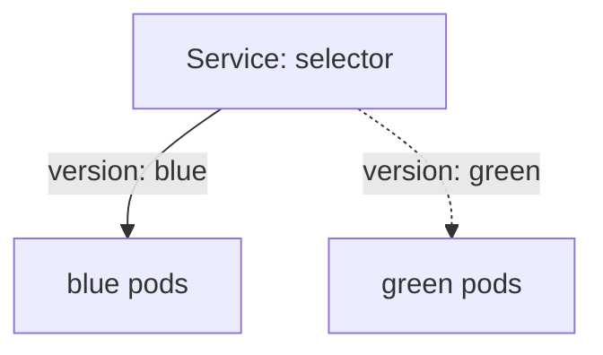

# Blue-Green, Canary And Release Evidence

A rolling update replaces pods in one Deployment. Sometimes a team wants more control: switch all traffic at one moment, or expose a new version to a small share of requests first. Blue-green and canary releases do this by running two versions at once and steering traffic between them. This part builds both with Deployments and a Service, then lists the evidence that justifies promoting a release or reversing it.

In a blue-green release, two complete environments exist: blue runs the current version and green runs the new one. A router sends all traffic to one of them. After green is verified, the router switches all traffic to green in one step, and blue stays running for a quick return. In a canary release, the new version receives a small share of traffic, and the team widens the share while the evidence stays good.



The diagram shows a Service whose label selector picks one version. Changing the selector from `blue` to `green` moves all traffic at once.

## Blue-green with a Service selector

A Service sends traffic to the pods whose labels match its selector. That makes the selector the switch. Save the two versions as `bluegreen.yaml`. Both Deployments have `app: lander`, and a `version` label separates them. The Service selects `blue`:

<!-- astrona:playground:renew -->

```yaml
apiVersion: apps/v1
kind: Deployment
metadata:
  name: lander-blue
  namespace: outpost
spec:
  replicas: 2
  selector:
    matchLabels:
      app: lander
      version: blue
  template:
    metadata:
      labels:
        app: lander
        version: blue
    spec:
      containers:
        - name: lander
          image: ghcr.io/stefanprodan/podinfo:6.15.0
          env:
            - name: PODINFO_UI_MESSAGE
              value: lander-blue
          ports:
            - name: http
              containerPort: 9898
          readinessProbe:
            httpGet:
              path: /readyz
              port: http
---
apiVersion: apps/v1
kind: Deployment
metadata:
  name: lander-green
  namespace: outpost
spec:
  replicas: 2
  selector:
    matchLabels:
      app: lander
      version: green
  template:
    metadata:
      labels:
        app: lander
        version: green
    spec:
      containers:
        - name: lander
          image: ghcr.io/stefanprodan/podinfo:6.15.0
          env:
            - name: PODINFO_UI_MESSAGE
              value: lander-green
          ports:
            - name: http
              containerPort: 9898
          readinessProbe:
            httpGet:
              path: /readyz
              port: http
---
apiVersion: v1
kind: Service
metadata:
  name: lander
  namespace: outpost
spec:
  selector:
    app: lander
    version: blue
  ports:
    - name: http
      port: 80
      targetPort: http
```

Apply it and wait for both versions:

```sh
kubectl apply -f bluegreen.yaml
kubectl -n outpost rollout status deployment/lander-blue --timeout=120s
kubectl -n outpost rollout status deployment/lander-green --timeout=120s
```

Verify green before it gets traffic. The Service still selects blue, so users see only blue. Read the answer from the Service, then ask a green pod directly with a port-forward:

```sh
kubectl -n outpost exec deploy/drifter -- curl -s http://lander.outpost.svc.cluster.local/ | grep message
kubectl -n outpost port-forward deployment/lander-green 9898:9898
```

In a second terminal, run `curl -s http://127.0.0.1:9898/ | grep message`. The answer holds `lander-green`. Stop the port-forward, then switch the Service to green and test again from `drifter`:

```sh
kubectl -n outpost patch service lander -p '{"spec":{"selector":{"app":"lander","version":"green"}}}'
kubectl -n outpost exec deploy/drifter -- curl -s http://lander.outpost.svc.cluster.local/ | grep message
```

The answer now holds `lander-green`. To return, patch the selector back to `blue`; the blue pods still run, so the return takes as long as the Service endpoints need to update. The price of blue-green is double capacity while both versions run.

## Canary with a replica ratio

A canary needs no extra tool in plain Kubernetes. Two Deployments carry the same label that the Service selects, and the share of traffic follows the pod counts, because the Service spreads requests across all ready pods. Three stable pods and one canary pod send about one request in four to the canary. Save this as `canary.yaml`:

```yaml
apiVersion: apps/v1
kind: Deployment
metadata:
  name: lookout-stable
  namespace: outpost
spec:
  replicas: 3
  selector:
    matchLabels:
      app: lookout
      track: stable
  template:
    metadata:
      labels:
        app: lookout
        track: stable
    spec:
      containers:
        - name: lookout
          image: ghcr.io/stefanprodan/podinfo:6.15.0
          env:
            - name: PODINFO_UI_MESSAGE
              value: lookout-stable
          ports:
            - name: http
              containerPort: 9898
          readinessProbe:
            httpGet:
              path: /readyz
              port: http
---
apiVersion: apps/v1
kind: Deployment
metadata:
  name: lookout-canary
  namespace: outpost
spec:
  replicas: 1
  selector:
    matchLabels:
      app: lookout
      track: canary
  template:
    metadata:
      labels:
        app: lookout
        track: canary
    spec:
      containers:
        - name: lookout
          image: ghcr.io/stefanprodan/podinfo:6.15.0
          env:
            - name: PODINFO_UI_MESSAGE
              value: lookout-canary
          ports:
            - name: http
              containerPort: 9898
          readinessProbe:
            httpGet:
              path: /readyz
              port: http
---
apiVersion: v1
kind: Service
metadata:
  name: lookout
  namespace: outpost
spec:
  selector:
    app: lookout
  ports:
    - name: http
      port: 80
      targetPort: http
```

Apply it, wait for both Deployments, and send twenty requests:

```sh
kubectl apply -f canary.yaml
kubectl -n outpost rollout status deployment/lookout-stable --timeout=120s
kubectl -n outpost rollout status deployment/lookout-canary --timeout=120s
kubectl -n outpost exec deploy/drifter -- sh -c 'for i in $(seq 1 20); do curl -s http://lookout.outpost.svc.cluster.local/ | grep message; done' | sort | uniq -c
```

The count shows both messages, with the canary answering a minority of the requests. The split follows the pod counts and is approximate, not exact. Widen the canary with `kubectl -n outpost scale deployment lookout-canary --replicas=2` and `kubectl -n outpost scale deployment lookout-stable --replicas=2`. Finer control, such as exactly one percent, needs a router that splits by weight, which a service mesh or an ingress controller provides.

## Evidence for promoting or reversing

Promote only on evidence that the new version is healthy under real traffic: all new pods are ready, the error rate of the canary is not higher than that of the stable version, latency is similar, and the logs show no new errors. Reverse when the evidence turns bad: pods fail readiness, the error rate rises or a key request fails. Decide the thresholds before the release, so the decision does not depend on opinion during an incident.

A rollback has limits. `kubectl rollout undo` and a switch back to blue restore the pod template and the traffic path. They do not restore a ConfigMap that changed, rows that the new version wrote to a database, or a schema migration that already ran. A rollback is safe only when the old version works with the current data, so a schema change should first be made backward compatible.

## Common pitfalls

> [!WARNING]
> A canary ratio from pod counts is approximate and changes when a pod restarts. A Service selector that matches a label shared by both versions sends traffic to both. A blue-green switch is not a rollback of data. Judging a canary on too few requests gives no reliable error rate.
