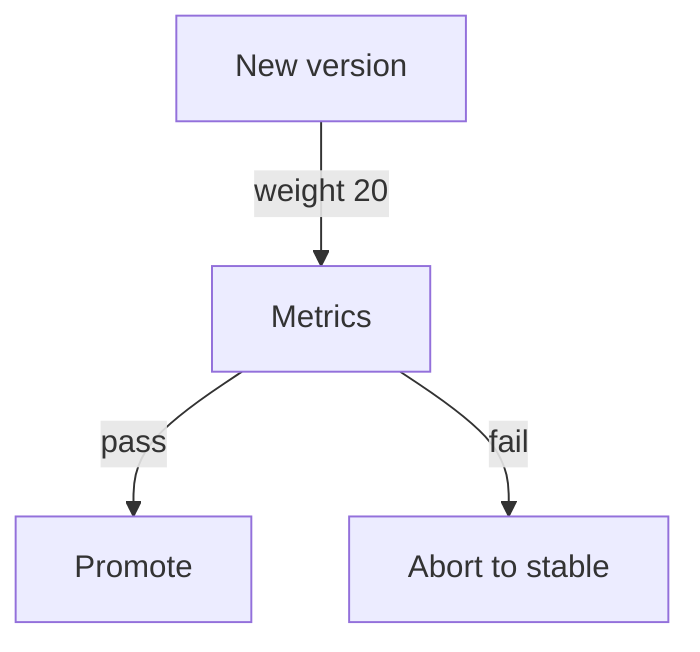

# Progressive Delivery Tooling

A canary release done by hand needs a person to change weights, read metrics and decide. Progressive delivery automates that loop. This part explains what the tools add to Kubernetes, how they decide to promote or abort, and what a rollout resource looks like. It also shows the limit of a plain Deployment that makes these tools necessary.

## What a Deployment cannot do

A Deployment rolls out pods in steps, and it checks only readiness. It cannot hold a rollout at 10% of traffic for ten minutes. It cannot read an error rate and stop. With plain Kubernetes Services, the traffic share equals the pod ratio, because the Service spreads requests across all ready pods.

<!-- astrona:playground:renew -->

Check what the cluster offers for rollout control in a Deployment:

```sh
kubectl explain deployment.spec.strategy
kubectl explain deployment.spec.strategy.rollingUpdate
```

The output lists `type`, and under `rollingUpdate` the fields `maxSurge` and `maxUnavailable`. No field sets a traffic percentage or a metric. Progressive delivery tools add that.

## Argo Rollouts

Argo Rollouts is a controller with a CRD named `Rollout`. A `Rollout` replaces a Deployment and has a pod template, and its `strategy` field holds either `blueGreen` or `canary`. The canary strategy lists steps:

```yaml
apiVersion: argoproj.io/v1alpha1
kind: Rollout
metadata:
  name: scout
spec:
  replicas: 5
  selector:
    matchLabels:
      app: scout
  strategy:
    canary:
      steps:
        - setWeight: 20
        - pause: {duration: 5m}
        - setWeight: 50
        - pause: {}
  template:
    metadata:
      labels:
        app: scout
    spec:
      containers:
        - name: scout
          image: ghcr.io/stefanprodan/podinfo:6.15.0
```

The steps run in order. `setWeight` sets the share of traffic for the new version. `pause` with a duration waits and `pause: {}` waits until a person promotes with the `kubectl argo rollouts promote` plugin command. Without a traffic router, Argo Rollouts approximates the weight by changing the number of pods. With a router, such as an Ingress controller, the Gateway API or a service mesh, it sets exact weights.

An `AnalysisTemplate` defines a metric query, for example the share of HTTP 5xx responses from Prometheus, and a success condition. A `Rollout` runs an analysis during a step. If the condition fails, the controller aborts and shifts traffic back to the stable version. This is automated promotion and automated rollback.

## Flagger

Flagger is a progressive delivery operator in the Flux family. It does not replace the Deployment. It watches a Deployment and a `Canary` resource, creates a primary copy of the workload and shifts traffic with a mesh or an Ingress controller. When the Deployment changes, Flagger runs the canary analysis, using metrics from Prometheus or another provider, increases the weight step by step and promotes or rolls back.

## Evidence for the decision

An automated gate needs the same evidence as a person: the request success rate, latency, error logs and resource use of the new version compared with the stable one. A gate based on a metric the new version does not affect proves nothing. The analysis needs enough traffic to be meaningful, so a canary at 1% of a quiet service gives noise.



The diagram shows the loop: the tool shifts a small weight, reads metrics and then either promotes or aborts.

## Common pitfalls

> [!WARNING]
> Replica-based canaries cannot give a 1% split with fewer than 100 pods. An analysis that queries a metric with no data can pass by mistake unless the template treats missing data as a failure. Rollout and Deployment resources must not manage the same pods. Progressive delivery tools need extra components, and the exam expects you to know them by purpose.
