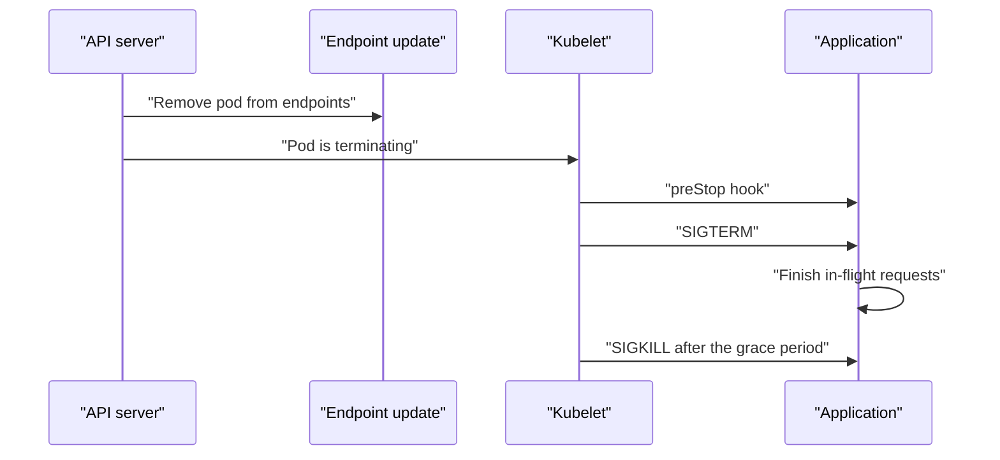

# Graceful Shutdown

A pod that is removed must finish what it is doing. Requests that arrive during the removal must go to other pods. This part shows the order of events when a pod ends and the settings that make it graceful.

## The sequence

When a pod is deleted or evicted, the API server sets a deletion time, and two things start in parallel:

1. The endpoint controllers remove the pod from the Service endpoints, so routers and proxies stop sending new requests.
2. The kubelet runs the `preStop` hook, sends the signal SIGTERM to the main process of each container, and waits.

If the container is still running after `terminationGracePeriodSeconds` (30 seconds by default), the kubelet sends SIGKILL, which cannot be handled.



The two parallel actions create a race. Some proxies learn about the removal slightly after the process has begun to stop, and send a request to a process that no longer accepts connections. The usual fix is a short pause in `preStop` before the shutdown starts.

<!-- astrona:playground:renew -->

Add these settings to the pod template of `dock` and apply it:

```yaml
    spec:
      terminationGracePeriodSeconds: 30
      containers:
        - name: dock
          lifecycle:
            preStop:
              sleep:
                seconds: 5
```

The `sleep` action of `preStop` is built into Kubernetes and needs no shell in the image. Check that the field is accepted by your cluster:

```sh
kubectl -n outpost patch deployment dock --type merge -p '{"spec":{"template":{"spec":{"terminationGracePeriodSeconds":30,"containers":[{"name":"dock","lifecycle":{"preStop":{"sleep":{"seconds":5}}}}]}}}}'
kubectl -n outpost rollout status deployment/dock --timeout=180s
```

## The application's part

The application must handle SIGTERM: stop accepting new connections, finish the requests in progress and exit with code 0. Many applications ignore the signal. A shell script as the main process often does not pass the signal on to its child. Use `exec` in the script so the application becomes the main process. The `preStop` time plus the shutdown time must fit inside `terminationGracePeriodSeconds`, because the grace period includes the hook.

## Readiness during shutdown

Some applications set their readiness to failing at the first SIGTERM, so that endpoint removal is certain, and then keep serving until the load stops. Check what your application does by watching the endpoints and the responses while you delete a pod.

Watch the endpoints from one terminal, and delete one named pod from another:

```sh
kubectl -n outpost get endpointslices -l kubernetes.io/service-name=dock -w
kubectl -n outpost delete pod POD_NAME
```

## Zero-downtime checklist

- A readiness probe that reflects real readiness.
- A `preStop` pause of a few seconds.
- SIGTERM handling in the application.
- A grace period longer than the longest request plus the pause.
- At least two replicas and a PodDisruptionBudget.

## Common pitfalls

> [!WARNING]
> A grace period shorter than the shutdown time kills requests with SIGKILL. A grace period that is very long delays every rollout, because the controller waits for each terminating pod only when the surge budget is used up. A `preStop` hook that fails still lets termination continue. Test shutdown by deleting a pod under load, not by reading the configuration.
