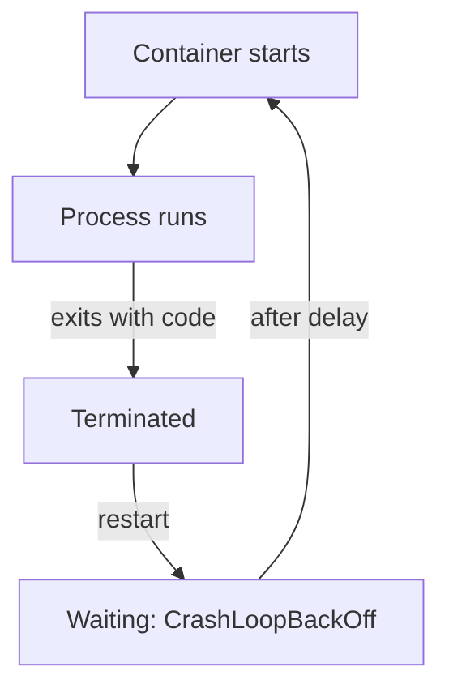

# Logs, Exits And Crash Loops

A pod that shows `CrashLoopBackOff` in `kubectl get pods` tells you only that something is wrong. It does not tell you what. The cause sits in three places: the container's log, the exit code and reason that Kubernetes recorded when the process ended, and the events that the kubelet and the controllers wrote. This part creates a crashing container and reads all three.

Kubernetes separates the life of a pod into a phase (`Pending`, `Running`, `Succeeded`, `Failed`) and the state of each container (`Waiting`, `Running`, `Terminated`). A container in `Waiting` has a reason, such as `ContainerCreating`, `ImagePullBackOff`, `CrashLoopBackOff` or `CreateContainerConfigError`. A container in `Terminated` has an exit code and a reason. The kubelet, the agent on each node, starts containers and restarts them according to the pod's `restartPolicy`.



The diagram shows the loop: the process exits, the kubelet restarts the container, and the delay between restarts grows each time.

## Create a crashing container

Save this as `deployment-crasher.yaml`. The container prints one line to standard error and exits with code `3`:

<!-- astrona:playground:renew -->

```yaml
apiVersion: apps/v1
kind: Deployment
metadata:
  name: crasher
  namespace: outpost
spec:
  replicas: 1
  selector:
    matchLabels:
      app: crasher
  template:
    metadata:
      labels:
        app: crasher
    spec:
      containers:
        - name: crasher
          image: curlimages/curl:8.22.0
          command: ["sh", "-c", "echo 'fatal: database password file not found' >&2; exit 3"]
```

Apply it and watch the pod status change:

```sh
kubectl apply -f deployment-crasher.yaml
kubectl -n outpost get pods -l app=crasher --watch
```

The pod goes through `Error` and then `CrashLoopBackOff`, and the `RESTARTS` counter rises. Stop the watch with Ctrl+C. After each crash the kubelet waits before it restarts the container. The delay starts at 10 seconds, doubles after each crash and stops growing at five minutes. During the delay the container is in `Waiting` with the reason `CrashLoopBackOff`; the reason names the waiting period, not the cause of the crash.

## Read the log of the dead container

`kubectl logs` reads the log of the current container. During the waiting period the current container may not exist yet, so the log can be empty. The flag `--previous` reads the log of the last terminated container:

```sh
kubectl -n outpost logs deployment/crasher --previous
```

The line `fatal: database password file not found` is the evidence of why the process stopped. This is the first place to look for a process failure. A pod with more than one container needs `-c <name>` to choose the container.

## Read the exit code and the reason

The pod status keeps the last termination record. Print it:

```sh
kubectl -n outpost get pods -l app=crasher -o jsonpath='{.items[0].status.containerStatuses[0].lastState.terminated}{"\n"}'
```

The record holds `exitCode: 3`, a `reason` of `Error`, and the start and finish times. The exit code has meaning. Code `0` is success. Code `1` and other small numbers are errors that the program chose. Code `127` means the shell did not find the command, and `126` means the file exists but cannot run. A code above `128` means a signal ended the process: `137` is `128 + 9`, a kill signal, and with the reason `OOMKilled` it means the container went over its memory limit; `143` is `128 + 15`, a normal stop request.

An application can also write its own explanation to the file `/dev/termination-log`, which Kubernetes copies into the termination record as the `message`. With `terminationMessagePolicy: FallbackToLogsOnError`, Kubernetes uses the last lines of the log when that file is empty and the exit code is not zero.

## Read the events

Events are short records that components write about an object. `kubectl describe` prints them at the end:

```sh
kubectl -n outpost describe pod -l app=crasher
```

Look at the section `Events`. It lists `Pulled`, `Created` and `Started`, and then a `BackOff` event with the text `Back-off restarting failed container`. The events show that the image was fine and the container did start. That separates a crash after the start from a failure before the start.

## Failures before the process starts

Two other states have different causes. `ImagePullBackOff` means the kubelet could not download the image: the name, the tag or the registry credentials are wrong. No process ran, so there is no log. `CreateContainerConfigError` means the kubelet could not build the container's configuration, for example because an environment variable refers to a ConfigMap key that does not exist; here too, no process ran. Create the first one on purpose by pointing a Deployment at a tag that does not exist:

```sh
kubectl -n outpost create deployment missing-image --image=curlimages/curl:does-not-exist
kubectl -n outpost get pods -l app=missing-image
kubectl -n outpost describe pod -l app=missing-image
```

The `Events` list a failed pull with the registry's answer. `kubectl logs` on this pod returns an error, because the container never started. The rule is: a log exists only for a container that started.

Clean up the examples:

```sh
kubectl -n outpost delete deployment crasher missing-image
```

## Common pitfalls

> [!WARNING]
> `CrashLoopBackOff` is a waiting state, not the cause. Read `kubectl logs --previous` and the last exit code. A pod that was never started has no log. Restarting the pod again and again does not add evidence; the second restart usually fails the same way. An exit code of `137` with a memory limit points at `OOMKilled`, not at a bug in the code path.
