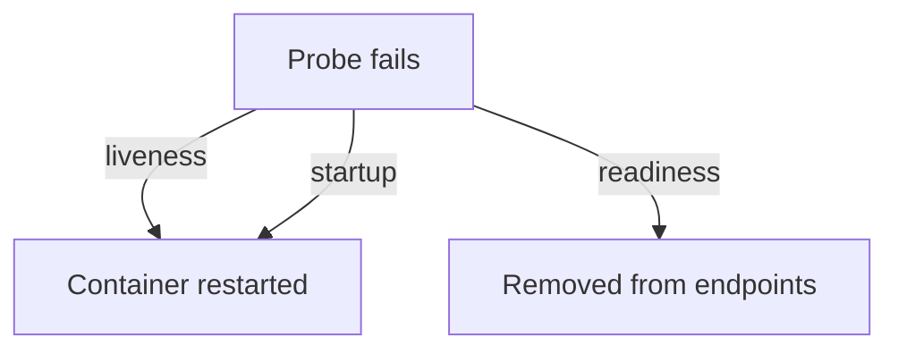

# Probes And Health Failures

A running process is not always a working application. Kubernetes uses probes to ask the application itself, and each probe type has a different consequence when it fails. Mixing them up causes two common faults: restarts of healthy applications and traffic to applications that cannot answer. This part separates the three probe types, shows the event text of each failure and builds one failing case of each kind.

## Three probes, three consequences

A probe is a check that the kubelet runs against a container: an HTTP GET, a TCP connection or a command inside the container.

- The startup probe runs first. While it has not succeeded, the kubelet runs no other probe. If it fails for `failureThreshold` times, the kubelet restarts the container. It protects slow-starting applications from a liveness probe that is too strict.
- The liveness probe asks whether the container is still alive. If it fails `failureThreshold` times in a row, the kubelet restarts the container.
- The readiness probe asks whether the container can take traffic. If it fails, the kubelet does not restart anything. The pod is marked not ready, and the endpoint controller removes it from the Service endpoints.

The settings are `initialDelaySeconds`, `periodSeconds` (default 10), `timeoutSeconds` (default 1), `successThreshold` and `failureThreshold` (default 3). A failure takes at least `periodSeconds` times `failureThreshold` to act.

## A failing liveness probe

<!-- astrona:playground:renew -->

Save this as `deployment-liveness-fail.yaml`. The liveness probe asks for a path that `podinfo` does not serve:

```yaml
apiVersion: apps/v1
kind: Deployment
metadata:
  name: liveness-fail
  namespace: outpost
spec:
  replicas: 1
  selector:
    matchLabels:
      app: liveness-fail
  template:
    metadata:
      labels:
        app: liveness-fail
    spec:
      containers:
        - name: app
          image: ghcr.io/stefanprodan/podinfo:6.15.0
          ports:
            - name: http
              containerPort: 9898
          livenessProbe:
            httpGet:
              path: /no-such-path
              port: http
            periodSeconds: 5
            failureThreshold: 2
```

Apply it:

```sh
kubectl apply -f deployment-liveness-fail.yaml
```

Then check the result after about a minute:

```sh
kubectl -n outpost get pods -l app=liveness-fail
kubectl -n outpost describe pod -l app=liveness-fail
```

The `RESTARTS` column grows. The events show `Unhealthy` with the text `Liveness probe failed` and the HTTP status the path returned, followed by `Killing` with a message that the container will be restarted. The kubelet ran the probe and restarted the container.

## A failing readiness probe

Change the probe from liveness to readiness. Save this as `deployment-readiness-fail.yaml`:

```yaml
apiVersion: apps/v1
kind: Deployment
metadata:
  name: readiness-fail
  namespace: outpost
spec:
  replicas: 1
  selector:
    matchLabels:
      app: readiness-fail
  template:
    metadata:
      labels:
        app: readiness-fail
    spec:
      containers:
        - name: app
          image: ghcr.io/stefanprodan/podinfo:6.15.0
          ports:
            - name: http
              containerPort: 9898
          readinessProbe:
            httpGet:
              path: /no-such-path
              port: http
            periodSeconds: 5
---
apiVersion: v1
kind: Service
metadata:
  name: readiness-fail
  namespace: outpost
spec:
  selector:
    app: readiness-fail
  ports:
    - port: 80
      targetPort: http
```

Apply it and look at the result:

```sh
kubectl apply -f deployment-readiness-fail.yaml
kubectl -n outpost get pods -l app=readiness-fail
kubectl -n outpost get endpoints readiness-fail
```

The pod shows `0/1` in the `READY` column and has no restarts. The endpoints object lists no addresses, so the Service sends no traffic. The event text is `Readiness probe failed`. A pod that runs but has no endpoints is the signature of a readiness failure.



The diagram shows that a liveness or startup failure restarts the container and a readiness failure only removes the pod from the endpoints.

## Common probe mistakes

A liveness probe that depends on a database restarts every pod when the database is down, and makes the outage worse. A probe with `timeoutSeconds: 1` fails on a slow but healthy application. A liveness probe without a startup probe kills a slow starter in a loop. Clean up with `kubectl -n outpost delete deployment liveness-fail readiness-fail` and `kubectl -n outpost delete service readiness-fail`.

## Common pitfalls

> [!WARNING]
> A readiness failure does not restart a pod, so waiting for a restart will not fix it. A liveness probe should check only the process itself. Read the probe failure from the events, because the log of the application may be empty.
