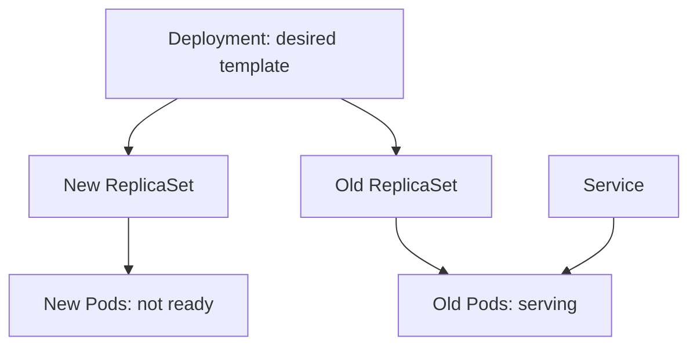

# Intended Versions And Observed Progress

A release has two sides. The intended side is what the Deployment declares: a Pod template with an image, environment values and probes. The observed side is what runs: ReplicaSets, Pods, their image identities and the traffic that reaches them. A failed release is a gap between the two. This part creates a release that stalls and reads the gap from the cluster.

A Deployment controller creates a new ReplicaSet whenever the Pod template changes. It scales the new ReplicaSet up and the old one down in steps. The strategy `RollingUpdate` limits the steps with two numbers: `maxSurge`, how many Pods above the desired count may exist, and `maxUnavailable`, how many Pods may be missing. A new Pod counts as available only after it is ready, so a Pod that never becomes ready stops the rollout while the old Pods keep serving.



The diagram shows a stalled rollout. The Service sends traffic only to ready Pods, so users keep reaching the old version.

## Create a healthy release

Save this as `deployment-lookout.yaml`:

<!-- astrona:playground:renew -->

```yaml
apiVersion: apps/v1
kind: Deployment
metadata:
  name: lookout
  namespace: outpost
spec:
  replicas: 2
  progressDeadlineSeconds: 60
  selector:
    matchLabels:
      app: lookout
  template:
    metadata:
      labels:
        app: lookout
    spec:
      containers:
        - name: lookout
          image: ghcr.io/stefanprodan/podinfo:6.15.0
          env:
            - name: PODINFO_UI_MESSAGE
              value: lookout-v1
          ports:
            - name: http
              containerPort: 9898
          readinessProbe:
            httpGet:
              path: /readyz
              port: http
```

Apply it and wait for the rollout:

```sh
kubectl apply -f deployment-lookout.yaml
kubectl -n outpost rollout status deployment/lookout --timeout=120s
```

The field `progressDeadlineSeconds` is the time the controller waits for progress before it marks the rollout as failed. The default is 600 seconds; this example uses 60 so a failure shows quickly.

## Release a version that cannot become ready

Change the readiness path to one that does not exist and change the message, which creates a new Pod template:

```sh
kubectl -n outpost patch deployment lookout --type json -p '[{"op":"replace","path":"/spec/template/spec/containers/0/readinessProbe/httpGet/path","value":"/missing"},{"op":"replace","path":"/spec/template/spec/containers/0/env/0/value","value":"lookout-v2"}]'
kubectl -n outpost get pods -l app=lookout
```

The list shows old Pods that are `1/1` ready and a new Pod that is `Running` but `0/1`. The container started, but the probe fails.

## Compare intent and observation

First read the intent. The Deployment holds the template and its revision number:

```sh
kubectl -n outpost get deployment lookout -o jsonpath='{.spec.template.spec.containers[0].image}{"\n"}{.spec.template.spec.containers[0].env[0].value}{"\n"}'
kubectl -n outpost get deployment lookout -o jsonpath='{.metadata.annotations.deployment\.kubernetes\.io/revision}{"\n"}'
```

Then read what exists. Each ReplicaSet carries its own revision and its Pod counts:

```sh
kubectl -n outpost get replicaset -l app=lookout -o custom-columns=NAME:.metadata.name,REVISION:.metadata.annotations.deployment\\.kubernetes\\.io/revision,DESIRED:.spec.replicas,READY:.status.readyReplicas
```

Two ReplicaSets exist. The new one has a higher revision and no ready Pods; the old one still has ready Pods. The status fields of the Deployment summarize the gap:

```sh
kubectl -n outpost get deployment lookout -o jsonpath='desired={.spec.replicas} updated={.status.updatedReplicas} ready={.status.readyReplicas} available={.status.availableReplicas} unavailable={.status.unavailableReplicas}{"\n"}'
```

A healthy completed rollout has `updated`, `ready` and `available` equal to `desired`. Here `updated` is higher than `ready`, which shows that new Pods exist but do not serve.

## Read the conditions and the events

The Deployment keeps two conditions. `Available` says that the minimum number of Pods is ready. `Progressing` says whether the rollout moves. After 60 seconds without progress, `Progressing` changes to `False` with the reason `ProgressDeadlineExceeded`:

```sh
kubectl -n outpost get deployment lookout -o jsonpath='{range .status.conditions[*]}{.type}={.status} reason={.reason}{"\n"}{end}'
kubectl -n outpost describe pod -l app=lookout
```

The Pod events show `Readiness probe failed` with the HTTP status the probe received, here `404`. The condition tells you that the rollout stalled. The Pod event tells you why. Reading both avoids a common mistake: the Deployment does not stop the new Pods and does not roll back on its own. It leaves the stalled state in place and waits for a person or a tool to act.

## Image identity

A tag such as `6.15.0` is a name that a registry can point at different content over time. A digest, which looks like `sha256:` followed by a long hash, names exactly one image. To see which image a running container uses, read `imageID` from the Pod status:

```sh
kubectl -n outpost get pods -l app=lookout -o jsonpath='{range .items[*]}{.metadata.name} {.spec.containers[0].image} {.status.containerStatuses[0].imageID}{"\n"}{end}'
```

Two Pods with the same `image` string can have different `imageID` values when a tag was moved between their start times. Compare the `imageID` of old and new Pods when users report old behavior although the new tag is deployed. Labels help to group Pods by version, but a label does not prove which image bytes run.

Clean up:

```sh
kubectl -n outpost delete deployment lookout
```

## Common pitfalls

> [!WARNING]
> A successful `kubectl apply` or `kubectl patch` means the API server accepted the change, not that the release works. A Pod that is `Running` is not necessarily ready. A Deployment does not roll back by itself when a rollout stalls. Matching image tags do not prove matching image content; compare `imageID`.
